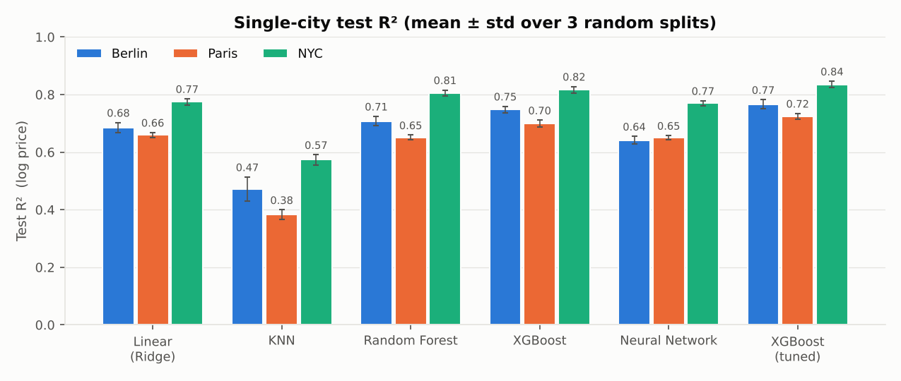
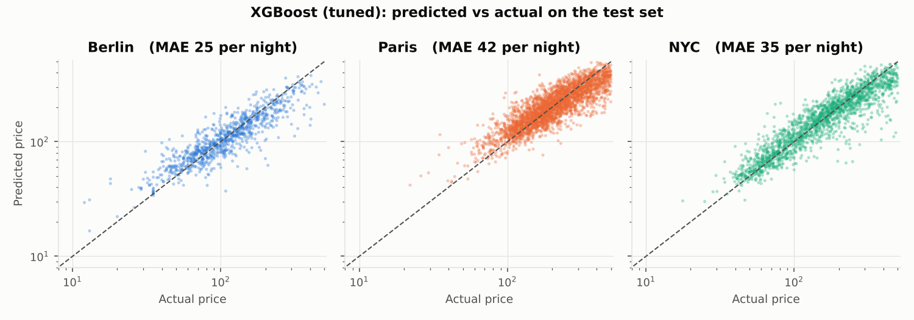
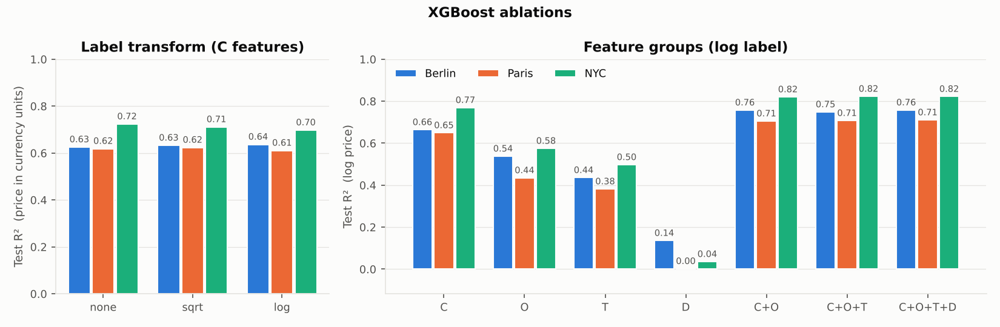
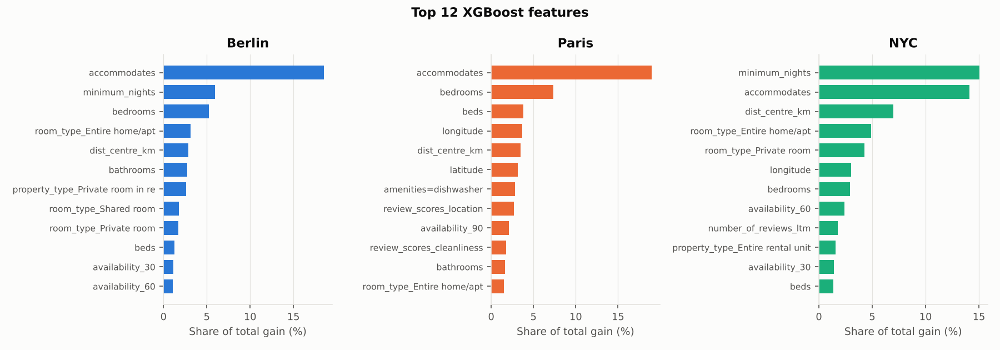
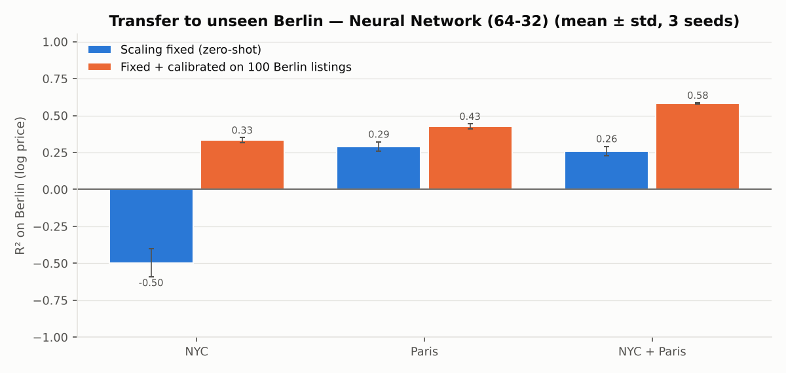

# Predicting Airbnb Listing Price Across Different Cities

UE24CS352A Machine Learning mini project. An improved re-implementation of
*"Predicting Airbnb Listing Price Across Different Cities"* (Luo, Zhou & Zhou, CS229 2019).

We predict the nightly price of Airbnb listings in **Berlin, Paris and NYC** with five models,
then test whether a model trained on NYC and/or Paris **transfers to Berlin**, a city it never sees.

> **Team:** Sakaray Vishal (PES1UG24AM241), Sreedharala Praneetha (PES1UG24AM281)



## What we improved over our first notebook

| Problem in `notebooks/original_colab.ipynb` | Fix |
|---|---|
| All columns z-scored, including 0/1 one-hots. A category that is rare in NYC becomes about 100σ in Berlin, so the cross-city NN gave R² = −8,244 | Only real-valued columns are scaled; 0/1 columns stay 0/1 |
| Sentinel values such as `maximum_nights = 2,147,483,647` | Continuous columns clipped to the training 1st–99th percentile |
| TF-IDF/SVD, medians and the amenity vocabulary were fitted on the full data before the split (leakage) | `FeatureBuilder` is fitted on the training rows only |
| ~5,000 one-hot amenity columns and per-listing `license` strings | Amenities kept if present in ≥ 1 % of listings; rare categories merged |
| One random split, so results changed between runs | 3 seeds, reported as mean ± std |
| One 1,000-line notebook | Small `src/` package plus scripts, tests and a demo |
| — | **New:** tuned XGBoost, distance-to-centre feature, ablations, calibration for a new city |

## Results

**Single city.** Test R² on log price, 70/20/10 split, mean ± std over 3 seeds. The number before the arrow is the old notebook's value.

| Model | Berlin | Paris | NYC |
|---|---|---|---|
| Linear (Ridge) | 0.578 → **0.685** ± 0.018 | 0.620 → **0.659** ± 0.009 | 0.713 → **0.775** ± 0.011 |
| KNN | 0.298 → **0.472** ± 0.042 | 0.313 → **0.383** ± 0.017 | 0.416 → **0.573** ± 0.017 |
| Random Forest | 0.673 → **0.708** ± 0.017 | 0.647 → **0.651** ± 0.008 | 0.799 → **0.805** ± 0.011 |
| XGBoost | 0.712 → **0.748** ± 0.011 | 0.723 → **0.699** ± 0.012 | 0.811 → **0.817** ± 0.011 |
| Neural network | 0.078 → **0.641** ± 0.013 | 0.509 → **0.650** ± 0.007 | 0.105 → **0.769** ± 0.009 |
| **XGBoost (tuned)** | **0.766** ± 0.016 | **0.724** ± 0.010 | **0.835** ± 0.011 |

The tuned XGBoost has a mean absolute error of **25 / 41 / 35** per night (Berlin / Paris / NYC).
The neural network gained the most from the scaling fix. Paris XGBoost is slightly lower than before:
the old single split happened to be a favourable one, and the tuned model is back at the old value.



**Ablations (XGBoost).** Size (`accommodates`, bedrooms), location and room type carry most of the signal.
Text adds little once C+O features are present, and dates alone are close to useless (same as the paper).
The log label raises R² *in log space*. Measured on actual prices, though, none / sqrt / log are within 0.03 of each other,
so the paper's Table 2 gain comes partly from comparing R² on different scales.




**Cross-city transfer to Berlin.** Berlin R², mean of 3 seeds. Berlin is never used for training.

| Trained on | Old notebook NN | NN, scaling fixed | NN + calibration | XGBoost + calibration |
|---|---|---|---|---|
| NYC | −8,244 | −0.497 | 0.333 | 0.266 |
| Paris | −88.3 | 0.290 | 0.426 | 0.468 |
| NYC + Paris | 0.088 | 0.259 | **0.581** | 0.531 |

* The huge negative values were the scaling bug, not a property of the data.
* Even when fixed, a zero-shot model over-predicts Berlin: Berlin is cheaper (median 103 vs 156 NYC and 203 Paris).
  No listing feature tells the model which city it is in.
* **Calibration:** train on price relative to each city's median, then fit `y = a + b·prediction` on just
  **100 labelled Berlin listings** (about 1 % of Berlin). This lifts the NYC+Paris network to **R² 0.58**,
  above the paper's 0.514, with an error of about 35 per night.
* As in the paper, training on **two cities transfers better than training on one**.



All numbers come from `results/*.csv`, which the scripts write.

## Project layout

```
├── src/
│   ├── config.py        # paths, column lists, settings
│   ├── data.py          # load, clean (price ≤ 500), 70/20/10 split
│   ├── features.py      # FeatureBuilder: C, O, T, D feature groups (fit on train only)
│   ├── models.py        # Ridge, KNN, RF, XGBoost (+tuned), MLPs from the paper
│   ├── single_city.py   # experiment 1 + ablations
│   ├── cross_city.py    # experiment 2 (transfer to Berlin)
│   └── plots.py
├── demo.py              # live demo: price a few unseen listings
├── tests/               # pytest smoke tests on synthetic data
├── results/             # CSVs + figures/
├── notebooks/original_colab.ipynb   # our first version (kept for reference)
├── data/README.md       # which files to download
└── docs/                # write-up
```

## Run

```bash
pip install -r requirements.txt
# put the 3 Inside Airbnb CSVs in data/  (see data/README.md)

python -m src.single_city      # ~25 min on 2 CPU cores  (--quick: 1 seed, ~6 min)
python -m src.cross_city       # ~25 min
python demo.py --city paris    # ~1 min, for the live demo
pytest -q                      # tests, no data needed
```

### Use the Google Drive folder

The scripts download the equivalent CSVs from the configured `raw` Google Drive
folder and reuse them from `.cache/airbnb_gdrive`:

```bash
python demo.py --city paris
python -m src.single_city --quick
python -m src.cross_city
```

The default folder can be overridden by setting `AIRBNB_GDRIVE_FOLDER` or by
passing `--gdrive-folder "https://drive.google.com/drive/folders/FOLDER_ID"`.
The folder must be accessible to the Google account/session used by `gdown`
("Anyone with the link" is the simplest setup). `--data-dir` takes precedence
over Google Drive and remains useful for offline tests.

## Method (short)

* **Data:** Inside Airbnb detailed listings for Berlin (Sep 2025), Paris (Mar 2026) and NYC (Jun 2026).
  We keep 0 < price ≤ 500 and predict log(price).
* **Features:** C (continuous) has 25 numeric columns plus lat/lon and distance to the city centre, with median-filled, clipped and standardised values.
  O (categorical) is one-hot columns plus multi-hot amenities and host verifications.
  T (text) is TF-IDF unigrams and bigrams reduced to a 50-d SVD per text column. D (dates) is days since 2008.
* **Models:** the paper's five, with the same settings, plus XGBoost tuned with early stopping on the dev set.
  The NN is 128-512-64 with Adam for single-city runs and 64-32 with SGD + Nesterov for transfer, as in the paper.
* **Cross-city** uses C+O without neighbourhoods. Each city's text vocabulary is different, so text features are left out (as in the paper).

## Limitations

Prices are in local currency (EUR vs USD). The scrapes are from different months.
The paper used 2019 Kaggle files, so our numbers are not directly comparable to theirs.

## Reference

Y. Luo, X. Zhou, Y. Zhou. *Predicting Airbnb Listing Price Across Different Cities.* CS229, Stanford, 2019.
